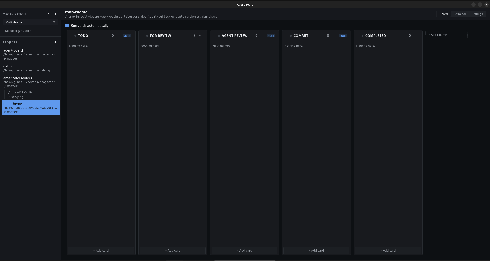

# Agent Board

A desktop Kanban board that runs coding agents. Columns carry a board type plus
the skill and command an agent runs for cards in them, so a card claims itself,
runs in its own git worktree, and moves to the column its exit code designates.

Next.js (static export) inside a Tauri v2 shell; Rust owns the terminal, git,
SQLite, indexing and notifications.



## Install

Download the installer for your system from the repo's Releases page:

| System | File | Install |
| --- | --- | --- |
| Windows (x64) | `Agent.Board_x.y.z_x64-setup.exe` or `.msi` | Run it. Installs per user; WebView2 is fetched if missing. |
| macOS (Apple Silicon / Intel) | `Agent.Board_x.y.z_aarch64.dmg` / `_x64.dmg` | Open it and drag Agent Board to Applications. |
| Debian / Ubuntu (x64, arm64) | `agent-board_x.y.z_amd64.deb` / `_arm64.deb` | `sudo apt install ./agent-board_*.deb` |
| Fedora / RHEL | `agent-board-x.y.z-1.x86_64.rpm` | `sudo dnf install ./agent-board-*.rpm` |
| Any Linux | `agent-board_x.y.z_amd64.AppImage` | `chmod +x` it and run it. |

The builds are not code-signed. On macOS, the first launch needs a right-click →
Open (or `xattr -dr com.apple.quarantine "/Applications/Agent Board.app"`). On
Windows, SmartScreen asks once — More info → Run anyway.

What the app drives has to be on the machine: the `claude` CLI and `git`;
`gh` for GitHub links. `tmux` (macOS, Linux) lets a card's agent outlive the
window and be rejoined; without it, and on Windows, a card's terminal ends with
the app. A launch from the Dock, Finder or a desktop menu picks up the same
PATH your login shell has, so tools installed through Homebrew, npm or a
version manager are found.

## Run it in development

```bash
npm install
npm run tauri dev
```

The window opens against a live Next dev server, so frontend edits hot-reload.
Data lives in a SQLite file under the OS app-data directory
(`~/.local/share/dev.agentboard.app/agent-board.db` on Linux), which is why
boards survive a restart.

## Build an installer

`npm run tauri build` produces installers **for the machine it runs on** — a
webview app cannot be usefully cross-compiled. Output lands in
`src-tauri/target/release/bundle/`.

| Host | You get |
| --- | --- |
| Linux | `.deb`, `.rpm`, `.AppImage` |
| Windows | `.exe` (NSIS, per-user) and `.msi` |
| macOS | `.app` and `.dmg` |

```bash
npm run tauri build                    # everything the host can make
npm run tauri build -- --bundles deb   # just one
```

Installing the Linux build:

```bash
sudo dpkg -i "src-tauri/target/release/bundle/deb/Agent Board_0.2.2_amd64.deb"
agent-board          # or launch "Agent Board" from your app menu
```

AppImage downloads `linuxdeploy` the first time it runs, so that target needs
network access.

## All three platforms at once

`.github/workflows/release.yml` builds on ubuntu-22.04, windows-latest and both
macOS architectures, then opens a draft release with every installer attached.
Pushing a tag matching `v*` publishes a draft release with every installer
attached; running it by hand from the Actions tab only builds, and the
installers come back as artifacts of that run. Linux is built for x64 and
arm64.

### Build requirements

- Rust (stable) and Node 22+ everywhere.
- Linux: `libwebkit2gtk-4.1-dev libgtk-3-dev librsvg2-dev patchelf libxdo-dev`.
- Windows: the WebView2 runtime (present on Windows 11, bundled by the installer).
- macOS: Xcode command line tools.

## Checks

```bash
npm run verify   # typecheck, lint, web tests, cargo check, cargo test
```
